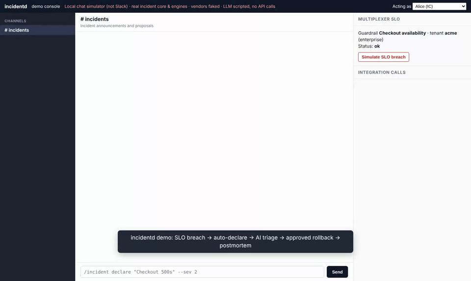

# incidentd: Incident Management Chatbot

Run the whole incident lifecycle from Slack (or Teams): **declare and coordinate**, **AI triage
with cited evidence**, **human-approved remediation**, and **blameless postmortems**. Built for
the 3 a.m. responder: fast, unambiguous, auditable.

[](docs/demo/incidentd-demo.mp4)

▶ **[Watch the 90-second demo](docs/demo/incidentd-demo.mp4)** · [what it shows](docs/demo.md)

## What it does

| Phase | Highlights |
|---|---|
| **Declare & coordinate** | `/incident declare`, war room, IC and roles, PagerDuty paging, Jira ticket, status cadence nudges. SLO breaches from Multiplexer are proposed or auto-declared (SEV1/SEV2 only), and one breach never creates two incidents. |
| **AI triage** | Claude runs **read-only** tools (Datadog, Kubernetes, SLOs). Ranked hypotheses must cite real tool calls or they are dropped in code. Secrets are redacted before the model sees anything. Suggestions come from a fixed catalog only. |
| **Remediation** | Catalog actions only, with a dry-run diff. Low: 1 approver · medium: IC · high: IC **and** service owner. Execution re-checks approvals from the hash-chained timeline and sits behind a two-key kill switch (**off in v1**). |
| **Postmortem** | TTD/TTA/TTM/TTR, error budget burned, similar past incidents (BM25), blameless draft, Jira action items. |
| **Audit** | Every step goes into an append-only, SHA-256 hash-chained timeline, enforced by database triggers and verifiable with `incidentd verify-timeline`. |
| **Observability** | Prometheus metrics, Grafana and Datadog dashboards, alert rules with runbooks. |

## Architecture



One Go service (`incidentd`) with ports and adapters: the core never imports a vendor SDK. More
diagrams: [deployment](docs/diagrams/deployment.svg) ·
[signal data flow](docs/diagrams/dataflow-signals.svg) ·
[triage data flow and trust boundaries](docs/diagrams/dataflow-triage.svg) ·
[remediation sequence](docs/diagrams/sequence-remediation.svg) · [all diagrams](docs/diagrams.md)

## Integrations

| | v1 | Planned (typed stubs today) |
|---|---|---|
| Chat | Slack · Microsoft Teams (optional) | |
| Paging | PagerDuty (REST + Webhooks v3) | Opsgenie |
| Observability | Datadog (read-only) | Prometheus/Alertmanager, Grafana |
| ITSM | Jira Cloud | ServiceNow |
| Runtime | Kubernetes (read-only; dry-run diffs) | AWS, GCP, Azure |
| SLO source | Multiplexer | Datadog SLOs, Nobl9 |
| LLM | Anthropic API (`claude-opus-5-5`) | Bedrock, Vertex (private endpoints) |

## Quick start

Try it with no credentials (demo console with real engines, fake vendors and a scripted LLM):

```bash
go run ./cmd/demo -listen 127.0.0.1:8090
```

Open <http://127.0.0.1:8090> and click **Simulate SLO breach**.

To run against your Slack workspace, see [Developer guide → Run locally](docs/development.md#run-locally).
To deploy to production, see the **[Deployment guide](docs/deployment.md)**.

## Commands

Slack `/incident <verb>` · Teams `@IncidentBot <verb>`

`declare` · `sev` · `role` · `status` · `update` · `triage` · `run` · `resolve` · `postmortem` · `timeline` · `help`

Details: [Responder guide](docs/user-guide.md).

## Documentation

| | |
|---|---|
| [Demo](docs/demo.md) | Video, screenshots, how the demo is built |
| [Architecture & design](docs/architecture.md) · [Diagrams](docs/diagrams.md) | Design decisions, ports, lifecycle, severity, verification log |
| [Deployment guide](docs/deployment.md) | Step by step: Postgres, Slack, Teams, PagerDuty, Datadog, Jira, Multiplexer, Kubernetes, secrets, verification, upgrades |
| [Configuration reference](docs/configuration.md) | Every key and secret |
| [Dashboards and alerting](docs/dashboards.md) | Metrics, Grafana/Prometheus/Datadog setup, alerts |
| [Operations runbook](docs/operations.md) | Alert runbooks, kill switch, audit verification, credential rotation |
| [Responder guide](docs/user-guide.md) | Using the bot during an incident |
| [Security model](docs/security.md) | Trust boundaries, approvals, LLM data handling |
| [Triage evaluation](docs/triage-evaluation.md) | Corpus, metrics, the gate that unlocks remediation |
| [Developer guide](docs/development.md) | Layout, tests, adding adapters, actions and metrics |

## Status

- **v1 complete:**
  - **Built and in use:** declare/coordinate, triage, remediation dry-run, postmortems, Slack, Teams, PagerDuty, Datadog, Jira, Kubernetes (read-only), Multiplexer, metrics and dashboards.
  - **Built but switched off:** remediation **execution**. It stays off until the triage evaluation passes on real (historical) incidents. See [triage-evaluation.md](docs/triage-evaluation.md).
- **Multiplexer prerequisites:** PRs [#5](https://github.com/streetsmartops/Multi-slo-observability-app/pull/5), [#6](https://github.com/streetsmartops/Multi-slo-observability-app/pull/6), [#7](https://github.com/streetsmartops/Multi-slo-observability-app/pull/7), [#8](https://github.com/streetsmartops/Multi-slo-observability-app/pull/8), [#9](https://github.com/streetsmartops/Multi-slo-observability-app/pull/9). Without #6 (service tokens), breaches are proposed but not auto-declared.
- **Unverified vendor details** are listed in [architecture.md Appendix A](docs/architecture.md#appendix-a--verification-log).

## Development

```bash
make test
```

`make test` runs the Go tests and the Python eval tests. CI also runs `go test -race` against Postgres 16.
See [docs/development.md](docs/development.md).
