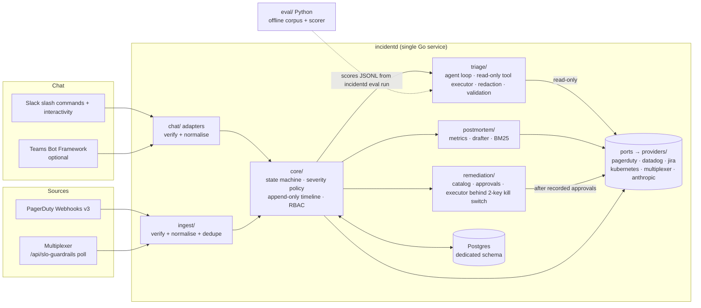
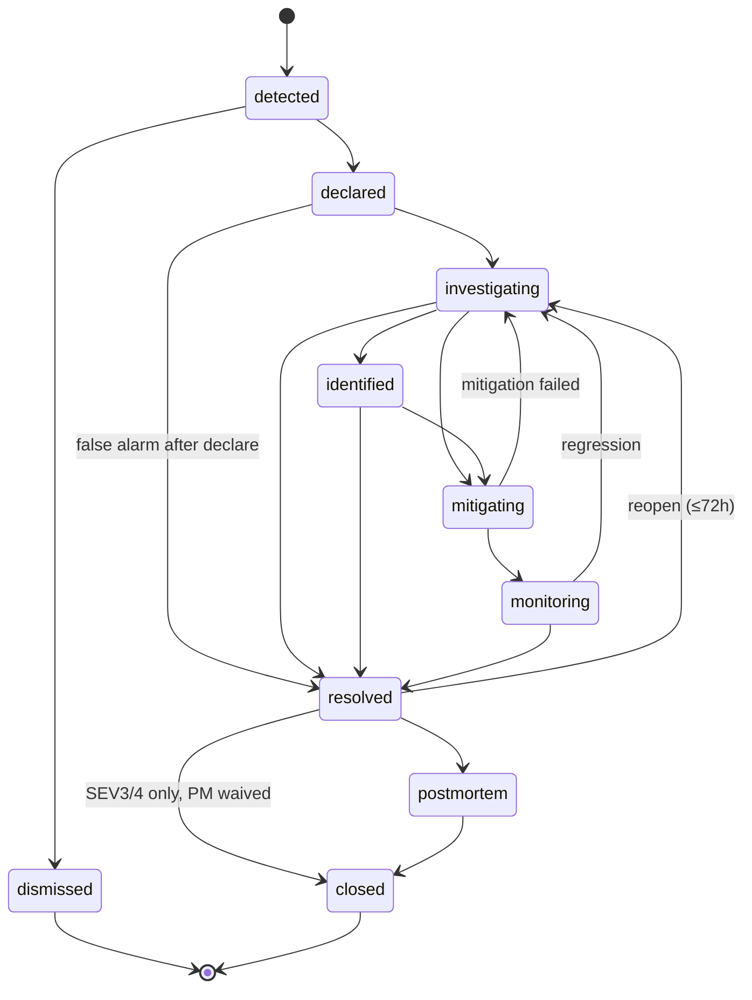
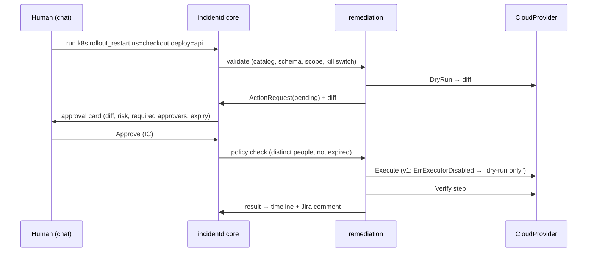

# Incident Management Chatbot — Architecture & Design (v1 proposal)

Status: **APPROVED (2026-11-10) — v1 implemented.** Changes made after approval are marked *(post-approval)*.
Owner: Platform/SRE · Last updated: 2026-11-10

Rendered diagrams (architecture, deployment, data flows, sequences, data model): [diagrams.md](diagrams.md).
Other docs: [docs/README.md](README.md).

Conventions: `UNVERIFIED` = a vendor detail I could not check against primary docs in this
session (doc hosts for Slack, PagerDuty and Microsoft were blocked by the network policy).
Everything about Multiplexer is verified from its source code (commit `e14d5ca`, `main`).

---

## 0. Agreed scope (Step 0 outcome)

| Decision | Choice |
|---|---|
| Chat | **Slack** (primary, v1). **Teams** optional: adapter built behind `chat.teams.enabled` |
| Paging / Observability / ITSM | PagerDuty / Datadog / Jira — live in v1 |
| Runtime | Kubernetes **read-only** live in v1. AWS: typed stub (v2) |
| SLO source | Multiplexer (`streetsmartops/Multi-slo-observability-app`) |
| Identity | Email match: Slack/Teams profile email = PagerDuty user email = Azure AD UPN |
| Approvals | low = 1 approver · medium = IC ≠ requester · high = IC + service owner (2 distinct people) |
| Auto-declare | **SEV1/SEV2 only**; SEV3/4 are proposed with one-click declare |
| LLM | Anthropic API (`claude-opus-5-5`) via `LlmPort`; Bedrock/Vertex adapters as stubs, private-endpoint ready |
| Remediation v1 | Catalog + approval engine built and tested; **executors disabled (dry-run only)** |
| Database | Dedicated Postgres schema (`database.schema`, default `incident_bot`) (Q3) |
| War rooms | Public by default; `declare --private` (Q4) |
| K8s clusters/namespaces, Jira project/issue types, vendor keys | Configured at deployment; every integration off until enabled (Q5, Q6) |
| Stack | **Go** single service incl. the agent loop (Q1 = Go); **Python** for the offline eval harness only — see §2.1 *(post-approval)* |
| Multiplexer PRs | Against `main`, each flagging that `dev` (per its CLAUDE.md) does not exist |
| Severity policy | Default matrix (§5), overridable by a company policy file |
| Triage eval | Synthetic fixtures now; optional historical import capped at **90 days** |

---

## 1. Reference architecture



### 2.1 Go service, Python eval *(post-approval: Q1 = Go)*

The agent loop moved into Go, so there is **one runtime service, `incidentd`**. The original
split (Python `brain` service) was dropped; its security property is kept *inside* the process:

- The model reaches vendors only through the **read-only tool executor** (`triage.LiveExecutor`).
  It has no write tools; only catalog IDs can become `ActionRequest`s, and only a human click
  creates one. Execution re-derives approvals from the hash-verified timeline (§8.4).
- Redaction happens in the executor before tool output is wrapped and sent to the LLM.
- **Python** (`eval/`) generates the synthetic corpus and scores eval runs. It is offline
  tooling: no credentials, not deployed.

### 2.2 Repository layout

```
cmd/incidentd/            Go entrypoint: serve | config-check | verify-timeline | eval
core/                     Go: domain model, state machine, timeline, severity policy, RBAC, ports, service, commands
chat/slack/  chat/teams/  Go chat adapters (Teams behind feature flag)
providers/                Go adapters: pagerduty/ datadog/ jira/ kubernetes/ multiplexer/
                          stubs (fail loudly): opsgenie/ servicenow/ prometheus/ aws/ gcp/ azure/
ingest/                   Go: webhook handlers, normalisers, Multiplexer poller, dedupe
remediation/              Go: catalog loader, approval engine, executor (disabled), catalog/*.yaml
triage/                   Go: agent loop, read-only tool executor, output validation, replay executor
postmortem/               Go: metrics, drafter, retrieval (BM25 v1, pgvector v2)
eval/                     Python: synthetic corpus generator, scorer + gate report
config/                   example config, severity-policy.yaml, approval-policy.yaml
db/migrations/            SQL migrations (Postgres 16)
test/fixtures/            recorded webhook payloads, Multiplexer responses, synthetic incidents
test/fakes, test/storetest  port fakes and the Store conformance suite
deploy/                   Helm chart, Slack app manifest, Teams app manifest
```

Config validation: the master prompt says "Zod-validated". Zod is TypeScript; the Go equivalent here is
typed structs decoded with unknown-field rejection plus an explicit `Validate()` that reports every
problem at once (`config/config.go`). Secrets are never accepted in YAML — only env `NAME` or
`NAME_FILE`.

---

## 3. Ports (core never imports a vendor SDK)

All Go ports live in `core/ports`. Each returns domain types only; vendor types never escape `providers/<x>/`.

| Port | Methods (v1) | v1 adapters | Stubs |
|---|---|---|---|
| `ChatPort` | `VerifyInbound(req) → Inbound` · `PostMessage(ch, Msg) → MsgRef` · `UpdateMessage(ref, Msg)` · `CreateWarRoom(name, private) → ChannelRef` · `Invite(ch, []UserRef)` · `SetTopic(ch, text)` · `PostApprovalCard(ch, ActionRequest) → MsgRef` · `LookupUserByEmail(email) → UserRef` · `UserEmail(UserRef) → email` | Slack | Teams (flagged, see §9 risk R2) |
| `PagingProvider` | `VerifyWebhook(req) → []Signal` · `WhoIsOnCall(serviceRef) → []Responder` · `Page(serviceRef, Incident, urgency) → PageRef` · `Acknowledge(PageRef)` · `Resolve(PageRef)` · `AddNote(PageRef, text)` | PagerDuty | Opsgenie |
| `ObservabilityProvider` | `Capabilities() → set` · `QueryMetric(q, from, to) → Series` · `SearchLogs(q, from, to, limit) → []LogLine` · `MonitorsInState(states, tags) → []Monitor` · `Events(tags, from, to) → []Event` | Datadog | Prometheus/Alertmanager, Grafana |
| `ItsmProvider` | `CreateIncidentTicket(Incident) → TicketRef` · `Update(TicketRef, fields)` · `Comment(TicketRef, text)` · `CreateActionItem(Postmortem, item) → TicketRef` | Jira Cloud | ServiceNow |
| `CloudProvider` | Read: `ListWorkloads(scope)` · `GetWorkload(ref)` · `Events(ref, since)` · `RolloutHistory(ref)` · `PodLogs(ref, since, tail)`. Write: `DryRun(Action) → Diff` · `Execute(Action) → Result` (**returns `ErrExecutorDisabled` in v1**) | Kubernetes (read) | AWS, GCP, Azure |
| `SloSource` | `ListSlos() → []Slo` · `GetSlo(id) → Slo` · `SloEvents(id, limit) → []SloEvent` · `TenantFor(sloID) → (Tenant, ok)` · `BudgetBurned(id, from, to) → (pct, quality)` | Multiplexer | Datadog SLOs, Nobl9 |
| `LlmPort` | `NewConversation(system, tools, maxTokens) → Send / SendToolResults` (adapter keeps opaque history incl. thinking blocks) | Anthropic API (official Go SDK, refusal fallbacks on) | Bedrock, Vertex (private endpoints: PrivateLink / Private Service Connect) |

`Capabilities()` drives which triage tools are exposed (§6.1): a tool is hidden if no configured adapter supports it.

### 3.1 Multiplexer `SloSource` mapping (verified from code)

| Port method | Multiplexer call | Notes |
|---|---|---|
| `ListSlos` | `GET /api/slo-guardrails` → `SloGuardrail[]` | No auth today (gap G1) |
| `GetSlo` | `GET /api/slo-guardrails/:id` → `{guardrail, events}` | |
| `SloEvents` | `GET /api/slo-guardrails/:id/events?limit=N` (N ≤ 500) → `{guardrail_id, events}` | `SloEvent` carries `uptime_percent`, `burn_rate`, `error_budget_remaining_percent` |
| `TenantFor` | v1: `GET /api/tenants` + `GET /api/tenants/:id/views` and join on `view_service_id → view_id` (requires gap G2 for auth) · after PR G3: `tenant` embedded in guardrail | `tier ∈ {enterprise, business, starter}` |
| `BudgetBurned` | difference of `error_budget_remaining_percent` between nearest events around the window | `quality=stale` until PR G4 (events only written on status change) |

Status mapping: Multiplexer `SloStatus` `ok | at_risk | breached | no_data | timeout` → `Signal.sloStatus` (same values).
Correlation: Multiplexer pages PagerDuty with `dedup_key = slo-guardrail-{id}` (`notifications/index.ts:30`). The
PagerDuty webhook normaliser extracts that key to link PD incidents to the guardrail, so the same breach seen
via PD and via the poller produces **one** signal.

---

## 4. Domain model

| Entity | Key fields |
|---|---|
| `Incident` | `id` (ULID), `key` (`INC-2026-0042`), `title`, `severity` SEV1–4, `state`, `services[]`, `tenants[]`, `roles{ic, comms, ops, scribe}`, `warRoom{platform, channelRef}`, `pageRefs[]`, `ticketRef`, `sloRefs[]`, `impactStartedAt`, `detectedAt`, `declaredAt`, `acknowledgedAt`, `mitigatedAt`, `resolvedAt`, `closedAt`, `statusCadence` (e.g. 30 m for SEV1), `correlationId` |
| `Signal` | `id`, `source` (pagerduty·multiplexer·datadog·manual), `externalId`, `dedupKey`, `service`, `tenant?`, `sloStatus?`, `severityHint`, `observedAt`, `payloadRef` (raw stored in blob table, redacted), `incidentId?` |
| `TimelineEvent` | `seq` (per incident, monotonic), `incidentId`, `at`, `actor{type: human·bot·system, id, email}`, `kind` (declared, sev_changed, role_assigned, status_posted, signal_attached, triage_requested, triage_result, action_requested, action_approved, action_denied, action_expired, action_dry_run, action_executed, transition, note, …), `payload` (JSON), `prevHash`, `hash` (SHA-256 chain) |
| `ActionRequest` | `id`, `incidentId`, `actionId` (catalog), `params`, `risk`, `requestedBy`, `source` (human·triage-recommendation), `dryRunDiff`, `approvals[{by, role, at}]`, `requiredApprovals`, `expiresAt`, `status` (pending·approved·denied·expired·executed·failed·verified), `verifyResult` |
| `Postmortem` | `incidentId`, `status` (draft·in_review·published), `sections{…}`, `metrics{ttd, tta, ttDeclare, ttm, ttr, budgetBurnedPct, budgetQuality}`, `actionItems[{title, owner, ticketRef, due}]`, `similarIncidents[{id, score}]` |

Timeline is **append-only**: the app's DB role has `INSERT, SELECT` only on `timeline_events` (no `UPDATE/DELETE`),
and each row hashes the previous one so tampering is detectable by `incidentd verify-timeline`.

---

## 5. Lifecycle & severity

### 5.1 State machine



Rules: every transition is a `TimelineEvent`; any other transition is rejected with the allowed list.
`resolved → closed` is blocked for SEV1/2 (postmortem mandatory). After 72 h a reopen is refused and the responder
declares a new incident (linking is manual in v1).

### 5.2 Default severity matrix (SLO status × tenant tier)

| SLO status ↓ / tier → | enterprise | business | starter | unknown tier |
|---|---|---|---|---|
| `breached` | **SEV1** | **SEV2** | SEV3 | SEV2 (proposed, never auto) |
| `at_risk` | **SEV2** | SEV3 | SEV4 | SEV3 (proposed) |
| `timeout` / `no_data` (monitoring gap) | SEV3 | SEV4 | SEV4 | SEV4 |

Modifiers: ≥ 3 tenants with a non-ok SLO on the same service → +1 level (max SEV1); tracked per process from
SLO signals. Manual `sev` always wins and is logged.

**Auto-declare rule (Q6 = b):** auto-declare iff computed SEV ∈ {SEV1, SEV2} **and** tier is known **and** the
status persisted ≥ 2 consecutive Multiplexer evaluations (~2 min, configurable) **and** no open incident already
holds the same `dedupKey`. Otherwise the bot posts a *proposal* card (Declare / Dismiss) to the triage channel.
`timeout`/`no_data` never auto-declare.

**Company policy override (Q11):** `config/severity-policy.yaml` replaces the matrix, modifiers and auto-declare
thresholds; validated at startup (restart to apply changes); its SHA-256 is logged at startup and recorded
on every `declared` timeline event.

---

## 6. Command surface (identical verbs on every platform)

Slack: `/incident <verb> …` · Teams: `@IncidentBot <verb> …` (plus Adaptive Card buttons). Same parser in `core/commands`.

| Verb | Syntax | Who |
|---|---|---|
| `declare` | `declare "<title>" [--sev N] [--service S]` | anyone |
| `sev` | `sev <1-4> [--reason "…"]` | IC |
| `role` | `role <ic\|comms\|ops\|scribe> @user` | IC (anyone may take IC if vacant) |
| `status` | `status [investigating\|identified\|mitigating\|monitoring]` — shows or transitions | IC |
| `update` | `update "<text>"` — stakeholder update, resets cadence timer | IC, comms |
| `triage` | `triage [--focus "…"]` | any participant |
| `run` | `run <actionId> [k=v …]` — creates an `ActionRequest`; never executes directly | participant (approval rules apply) |
| `resolve` | `resolve ["summary"]` | IC |
| `postmortem` | `postmortem [draft\|publish]` | IC |
| `timeline` | `timeline [--last N]` | anyone |

Status cadence: SEV1 30 m, SEV2 60 m, SEV3/4 none; the bot nudges the IC when overdue.

---

## 7. AI triage (Step 2)

### 7.1 Tools exposed to the model (read-only only)

| Tool | Port method | Shown when |
|---|---|---|
| `get_incident_context` | core (timeline, signals, services) | always |
| `get_slo_status` / `get_slo_events` | `SloSource` | SloSource configured |
| `query_metric` | `ObservabilityProvider.QueryMetric` | capability `metrics` |
| `search_logs` | `ObservabilityProvider.SearchLogs` | capability `logs` |
| `list_alerting_monitors` | `ObservabilityProvider.MonitorsInState` | capability `monitors` |
| `list_events` (deploys, config changes) | `ObservabilityProvider.Events` | capability `events` |
| `list_k8s_workload` / `k8s_events` / `rollout_history` / `pod_logs` | `CloudProvider` read methods | k8s adapter enabled, scope in allow-list |
| `who_is_on_call` | `PagingProvider.WhoIsOnCall` | always |
| `search_similar_incidents` | postmortem retrieval | ≥ 1 closed incident |

There is no write tool. `recommendedActions` are text proposals; turning one into an `ActionRequest` requires a human click.

### 7.2 Output contract (`triage.Result`; tool schema in `triage/agent.go` `submitSchema`)

```json
{
  "summary": "string ≤ 600 chars",
  "blastRadius": {"services": ["…"], "tenants": ["…"], "regions": ["…"], "userImpact": "string"},
  "hypotheses": [{
    "cause": "string",
    "confidence": 0.0,
    "evidence": [{"tool": "query_metric", "ref": "call_07", "finding": "p99 latency 4.1s from 10:42Z"}]
  }],
  "recommendedActions": [{"actionId": "k8s.rollout_undo", "params": {}, "rationale": "…", "risk": "high"}],
  "missingData": ["string"]
}
```

### 7.3 Guardrails

| Guardrail | Enforcement (in code, not prompt) |
|---|---|
| Budget | ≤ 15 tool calls, ≤ 90 s wall clock, ≤ 8 KB per tool result (truncated with marker); on exhaustion return partial result with `missingData` |
| Citations | Every `evidence.ref` must equal a tool-call ID from this run; hypotheses with zero valid refs are **dropped**; drop count logged |
| Prompt injection | Tool output wrapped as untrusted data in a delimited block; system prompt states it is data, not instructions; model has no write tools; actions restricted to catalog IDs regardless of output |
| Redaction | Go gateway redacts before returning: secrets (key/token patterns, `Authorization:` headers, AWS key IDs, JWTs, connection strings), emails → hashed tokens, IPs optional; per-adapter allow-list of fields |
| Action restriction | `recommendedActions[].actionId` ∉ catalog → removed; params validated against catalog schema; `risk` overwritten from catalog |
| Schema | Strict decode (unknown fields rejected); one repair retry on an invalid result; then fail closed with an error |
| Confidence | Shown as Low/Med/High buckets, never a bare percentage, to avoid false precision at 3 a.m. |

### 7.4 Evaluation plan (Q12)

- **Corpus:** ≥ 20 synthetic incidents in `test/fixtures/incidents/` (recorded-shape tool responses + ground-truth
  root cause + "evidence that matters"). Labelled **`NOT REPRESENTATIVE`** in every report.
- **Historical (optional):** `incidentd eval import-pagerduty --since 2160h` writes skeleton fixtures for resolved
  PagerDuty incidents (hard cap 90 days, titles redacted). A human labels the ground truth and adds recordings;
  unlabelled fixtures are skipped by the scorer. Jira/Slack history import is not in v1.
- **Metrics:** top-1 hypothesis accuracy, top-3 accuracy, evidence precision (cited refs judged relevant / all
  cited refs), uncited-hypothesis rate (must be 0 after filtering), non-catalog action rate (must be 0), p95 latency,
  cost per run.
- **Scoring:** cause match by a rubric (human-labelled; LLM-judge allowed only as a second rater, never sole).
- **Gate to enable remediation (see §10):** on ≥ 20 incidents of which ≥ 10 historical: top-1 ≥ 60 %, top-3 ≥ 80 %,
  evidence precision ≥ 90 %, p95 ≤ 90 s. Synthetic-only results cannot open the gate.

---

## 8. Remediation (Step 3) — human-in-the-loop

### 8.1 Catalog (`remediation/catalog/*.yaml`, version-controlled, CODEOWNERS = SRE leads)

```yaml
id: k8s.rollout_restart
provider: kubernetes
risk: low
params:                    # JSON Schema
  type: object
  required: [namespace, deployment]
  properties:
    namespace: {type: string, pattern: "^[a-z0-9-]{1,63}$"}
    deployment: {type: string, pattern: "^[a-z0-9-]{1,253}$"}
allowedScopes:
  clusters: [prod-eu-1, prod-us-1]
  namespaces: ["payments-*", "checkout"]
verify:
  type: rollout_status
  timeout: 5m
```

v1 catalog: `k8s.rollout_restart` (low) · `k8s.scale_deployment` (medium, 1–50 replicas) · `k8s.rollout_undo` (high).
*(post-approval)* `datadog.mute_monitor` and `pagerduty.escalate` moved to v2: they need write
adapters for Datadog/PagerDuty, and v1 keeps those integrations read-only / paging-only.
Parameter specs are a constrained JSON-Schema subset (type, required, pattern, enum, min, max);
unknown parameters are rejected.

### 8.2 Approval policy

| Risk | Required | Constraints |
|---|---|---|
| low | 1 approver | approver may be the requester only if they are the IC |
| medium | IC | IC ≠ requester |
| high | IC **and** service owner | two distinct people, neither is the requester; service owner from Multiplexer `services.owner` → email → chat user |

Approvals expire after **15 min** (configurable); expiry is a timeline event. Re-approval required if params change.
Approver identity = verified chat user → email → must match an active PD/directory user.

### 8.3 Flow



### 8.4 Controls

- **Kill switch:** env `REMEDIATION_ENABLED=false` (default in v1) **and** runtime DB flag toggled by `admin` role; both must be true.
- **No free-form shell** from chat, ever. Unknown `actionId` is rejected.
- **K8s RBAC:** v1 ServiceAccount gets `get, list, watch` on `pods, pods/log, events, deployments, replicasets` only.
  The write Role (`patch` on `deployments` for restart/undo, `update` on `deployments/scale`) ships as a separate
  manifest, **not applied in v1**, namespace-scoped to catalog `allowedScopes`.
- Invariant (tested): no code path calls `CloudProvider.Execute` without an `ActionRequest` whose approvals satisfy policy **and** are recorded in the timeline first.

---

## 9. Postmortem & learning (Step 4)

Draft sections: summary · impact (services, tenants, duration, **error budget burned** from `SloSource.BudgetBurned`
with quality flag) · detection · timeline (from timeline events) · root cause · contributing factors · what went well /
badly · action items (→ Jira). Blameless language check: drafter is instructed and a linter flags person-blaming phrasing.

| Metric | Definition |
|---|---|
| TTD | `detectedAt − impactStartedAt` (impact start = earliest attached signal's onset, editable by IC) |
| TTA | `acknowledgedAt − detectedAt` (first PD ack or IC assignment) |
| Time-to-declare | `declaredAt − detectedAt` |
| TTM | `mitigatedAt − impactStartedAt` (first entry to `monitoring`) |
| TTR | `resolvedAt − impactStartedAt` |
| Budget burned | `SloSource.BudgetBurned(slo, impactStart, resolvedAt)`; flagged `stale` until Multiplexer gap G4 is fixed |

Similar-incident retrieval: v1 **BM25** (`rank-bm25`) over title, summary, root cause, services, top log signatures;
v2 pgvector embeddings with hybrid ranking.

---

## 10. Security model

| Area | Control |
|---|---|
| Slack inbound | Signing-secret HMAC-SHA256 over `v0:{timestamp}:{body}`, header `X-Slack-Signature`, reject if `X-Slack-Request-Timestamp` skew > 5 min — verified (docs.slack.dev) |
| Teams inbound | Bot Framework JWT: OpenID metadata/JWKS, issuer `https://api.botframework.com`, audience = app ID, 5 min skew, `serviceUrl` claim, key endorsements for `channelId` — verified (learn.microsoft.com) |
| PagerDuty inbound | Webhooks v3 HMAC-SHA256 over raw body, header `X-PagerDuty-Signature` (`v1=…`, comma-separated) — verified from `go-pagerduty` v1.8.0 `webhookv3` source (PagerDuty docs host still unreachable) |
| Multiplexer | Bot uses a scoped service token (`views:read`) once PR G2 lands; until then only the unauthenticated guardrail GETs are usable |
| Identity | chat user → profile email → PD user / Azure AD UPN; unmapped users can read and `declare` but cannot approve |
| Credentials | One credential per adapter, least privilege (PD: read + incident write; Jira: one project; Datadog: read-only app key scopes; K8s: read-only SA); loaded from mounted secrets (K8s Secret / Vault agent), never env-logged, never in prompts |
| LLM data | Redaction in Go gateway; no raw payloads to the LLM; Anthropic API over TLS; Bedrock/Vertex adapters require private endpoints |
| Audit | Hash-chained append-only timeline; structured logs with `incident_id` + `correlation_id`; approvals record who/when/what diff |
| Admin API | `POST /admin/remediation?enabled=`, `GET /admin/timeline/verify` behind `INCIDENTD_ADMIN_TOKEN` (constant-time compare) |

---

## 11. Roadmap & exit gates

| Phase | Scope | Exit gate (measurable) |
|---|---|---|
| P0 Foundations | Repo, CI (gofmt, go vet, `go test -race` incl. Postgres service, pytest, fixture drift check), config, migrations, health | CI green; config fails fast on invalid input |
| P1 Declare & coordinate | Slack: all 10 verbs, war room, roles, PD paging, Jira ticket, cadence, timeline; Multiplexer + PD ingest; auto-declare SEV1/2; Teams adapter behind flag | Game-day: declare→resolve end-to-end on Slack; 100 % of commands produce timeline events; signature-verification tests pass on recorded fixtures; duplicate PD+Multiplexer signal → 1 incident |
| P2 Triage | Read-only tool executor, agent loop, validation, guardrails, eval harness | §7.4 metrics reported on ≥ 20 incidents; 0 uncited hypotheses; 0 non-catalog actions |
| P3 Remediation (dry-run) | Catalog, approval engine, approval cards, dry-run diffs | Approval-policy tests incl. two-person + expiry; invariant test (§8.4) |
| P3b Remediation live (low risk) | Apply write RBAC, flip kill switch for `low` only | **Only after P2 gate passes with ≥ 10 historical incidents** + security review sign-off |
| P4 Postmortem | Drafter, metrics, action items → Jira, BM25 | Metrics match hand-computed values on fixtures; IC accepts draft with edits on ≥ 3 drill incidents |
| v2 | Teams GA, AWS adapter, pgvector, Bedrock/Vertex, Multiplexer outbound webhook, Datadog monitor webhook ingest | — |

---

## 12. Multiplexer gap PRs (against `main`, each noting the missing `dev` branch)

| ID | Gap | PR | Tests |
|---|---|---|---|
| G1 | `/api/slo-guardrails/**` had no permission checks; unauthenticated GETs returned `pagerduty_service_key`; `POST /api/notifications/test` (fires real PD/Jira notifications) had no auth | [streetsmartops/Multi-slo-observability-app#5](https://github.com/streetsmartops/Multi-slo-observability-app/pull/5) | 25 vitest: 401/403/2xx per handler, key never returned |
| G2 | Cookie-session-only auth; no machine identity | [streetsmartops/Multi-slo-observability-app#6](https://github.com/streetsmartops/Multi-slo-observability-app/pull/6): hashed, scoped, expiring `mpx_` service tokens (V10), CSRF skipped only for bearer requests | 9 vitest |
| V9 *(found during G2)* | `V9__multi_tenant_saas.sql` fails on PostgreSQL (`NOW()` in a partial index predicate), so tenant tables are never created | [streetsmartops/Multi-slo-observability-app#7](https://github.com/streetsmartops/Multi-slo-observability-app/pull/7) | migration lint test; V1–V9 applied to Postgres 16 |
| G3 | Guardrail → tenant required 3 joins client-side | [streetsmartops/Multi-slo-observability-app#8](https://github.com/streetsmartops/Multi-slo-observability-app/pull/8): `tenant {id, slug, tier}` embedded (the bot already uses it when present) | 2 vitest + SQL verified on Postgres |
| G4 | Current burn rate / budget only on transition events | [streetsmartops/Multi-slo-observability-app#9](https://github.com/streetsmartops/Multi-slo-observability-app/pull/9): `last_*` metrics persisted each cycle (V11) | 2 vitest |
| G5 (v2) | No generic outbound webhook | not started | — |

Merge order: #7 (V9) → #6 (V10) → #9 (V11); #5 and #8 are independent. After #6, create a
`views:read` token for the bot and set `MULTIPLEXER_TOKEN`.

Note: Multiplexer's budget math weights `yellow` at 0.5 and counts `no_data` as bad (`slo-guardrails.ts:93`).
Postmortem figures will differ from Datadog SLOs; documented, not changed.

---

## 13. Risks

| # | Risk | Mitigation |
|---|---|---|
| R1 | Vendor details marked UNVERIFIED are wrong | Verify against docs before P1 code freeze (needs doc hosts allowed, or you confirm); recorded-fixture tests per adapter |
| R2 | **No maintained Go SDK for Teams.** `msbotbuilder-go` last released 2021-10 | Implemented the Bot Framework REST protocol directly in Go (`chat/teams`), Q2 = as proposed. Python sidecar on the Agents SDK remains the fallback |
| R3 | Two languages = two toolchains | Python limited to offline eval tooling; one CI pipeline |
| R4 | Auto-declare noise from flapping SLOs | 2-evaluation persistence, dedupe on `dedupKey`, SEV1/2 only, weekly review of auto-declares |
| R5 | Budget burned is stale until G4 | `quality` flag shown in postmortem |
| R6 | LLM hallucinated causes | Citation enforcement in code; confidence buckets; remediation gated on eval |

## 14. Decisions on the Step 1 open questions

| Q | Decision |
|---|---|
| Q1 | Agent loop in **Go** |
| Q2 | Teams in Go (REST protocol), as proposed |
| Q3 | Dedicated Postgres schema (`database.schema`) |
| Q4 | War rooms public by default |
| Q5 | Clusters/namespaces configured at deployment (`kubernetes.clusters[]`) |
| Q6 | Jira project and issue types configured at deployment |
| Q7 | Doc hosts allowed; Slack, Teams, Jira, Datadog verified; PagerDuty docs host still unresolvable (verified from SDK source instead) |

Remaining open items: Teams member `email`/`userPrincipalName` fields and the PagerDuty v3
`incident_key` field and full event-type list are `UNVERIFIED` (see Appendix A).

---

## Appendix A — Verification log

| Item | Status | Source |
|---|---|---|
| Multiplexer endpoints, types, auth, PD dedup key `slo-guardrail-{id}`, PD title `SLO Breach: {name}`, tenant `view_ids`, view `service.owner` | Verified | Source code, `main@e14d5ca` |
| Multiplexer `dev` branch | **Absent** (only `main` + 4 feature branches) | `git branch -a` |
| Datadog: `GET /api/v1/query`, `POST /api/v2/logs/events/search`, `GET /api/v1/monitor` (`group_states`, `monitor_tags`), `GET /api/v2/events` (`filter[...]`), headers `DD-API-KEY` / `DD-APPLICATION-KEY`, response field names | Verified | docs.datadoghq.com + datadog-api-client-go v2.67.0 models |
| Slack: request signing, slash-command fields, 3 s ack, `response_url`, `block_actions` payload, method scopes | Verified | docs.slack.dev |
| Teams: Bot Connector JWT rules, token endpoint/scope, `/v3/conversations/...` activities and members endpoints, `<at>` mentions | Verified | learn.microsoft.com |
| Teams member `email` / `userPrincipalName` fields | **UNVERIFIED** | docs page shows SDK samples only |
| Jira Cloud v3: `POST /rest/api/3/issue`, `POST /rest/api/3/issue/{key}/comment`, ADF bodies, Basic `email:api_token` | Verified | developer.atlassian.com |
| PagerDuty: v3 signature scheme, envelope, REST calls, `From` header for notes | Verified from source | go-pagerduty v1.8.0 |
| PagerDuty: full v3 incident event-type list; `incident_key` in v3 incident data | **UNVERIFIED** | developer.pagerduty.com unresolvable from this environment |
| Anthropic: official Go SDK v2.8.0 beta Messages, `fallbacks: "default"` + `server-side-fallback-2026-07-01`, adaptive thinking default on `claude-opus-5-5`, effort via `output_config` | Verified | SDK source + Claude API reference |
| Go modules: slack-go v0.35.0, go-pagerduty v1.8.0, client-go v0.37.2, pgx v5, golang-jwt v5.3.1, anthropic-sdk-go v2.8.0 | Verified | proxy.golang.org |
| Toolchain: Go 1.26.0, Python 3.13 | Verified | local |
