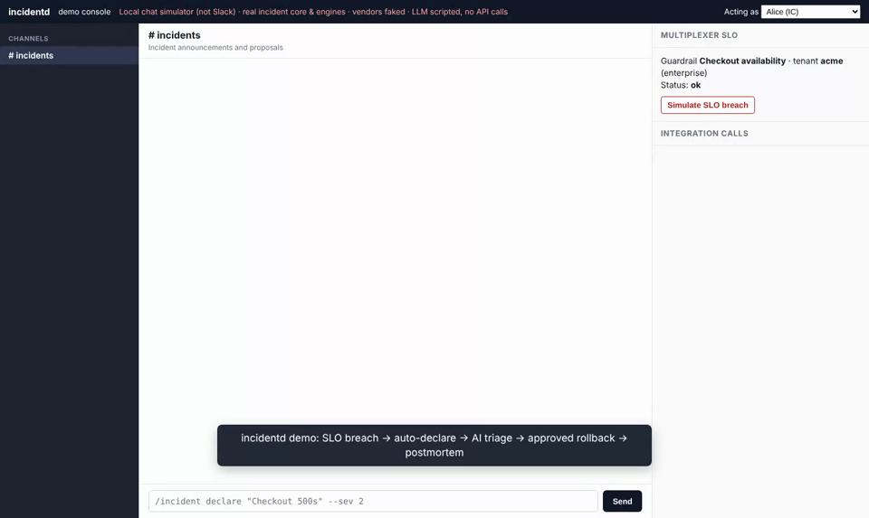
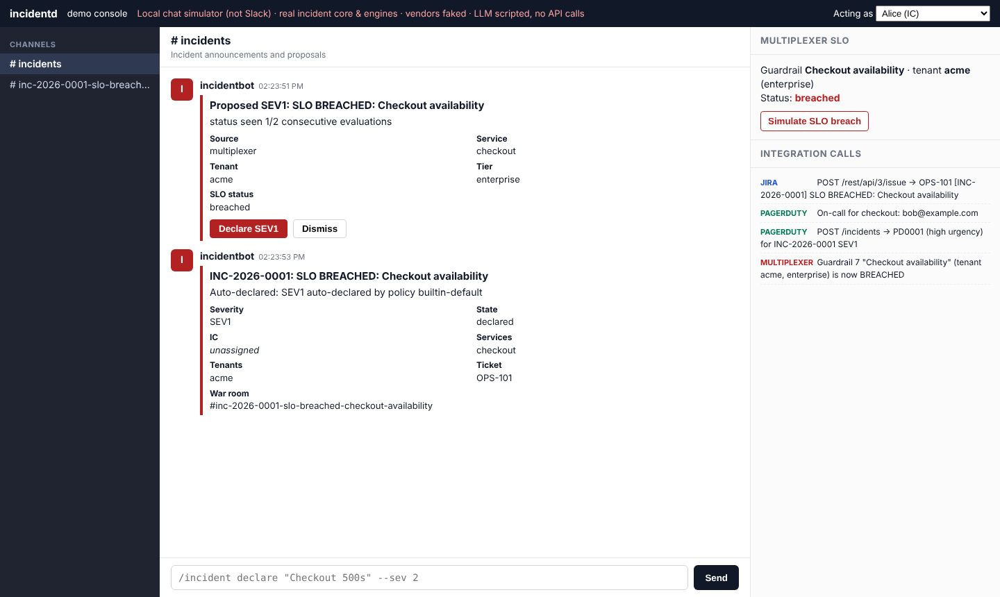
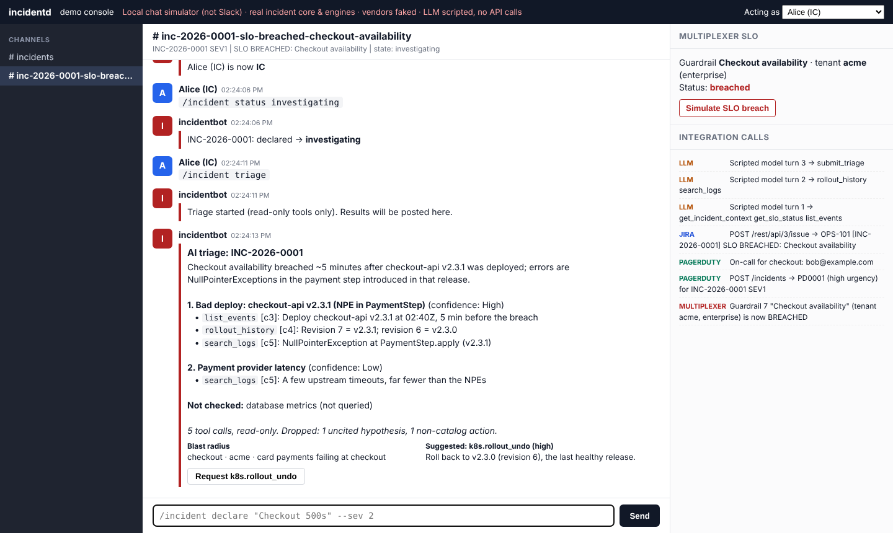
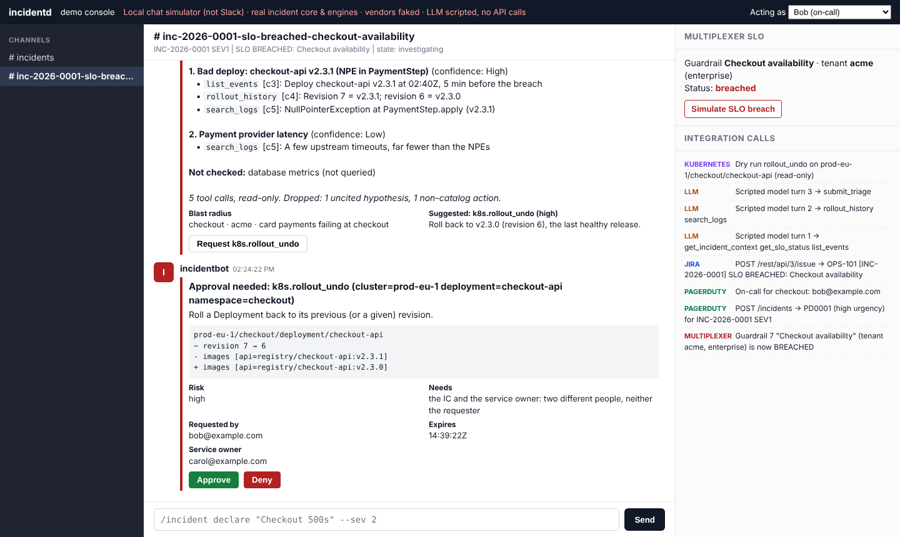
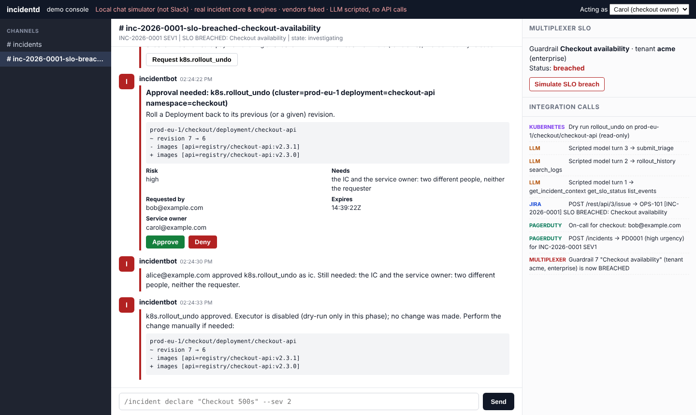
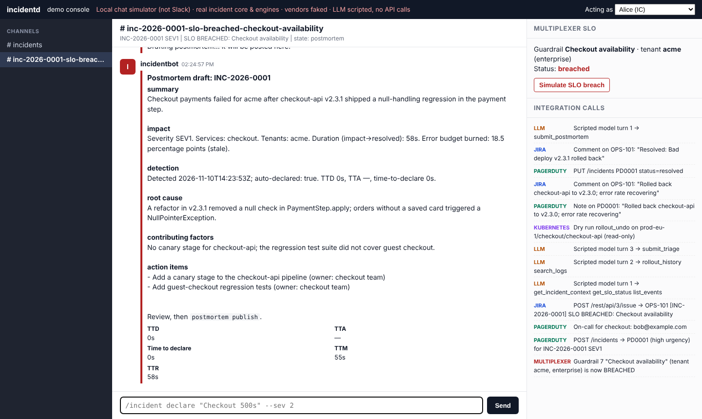
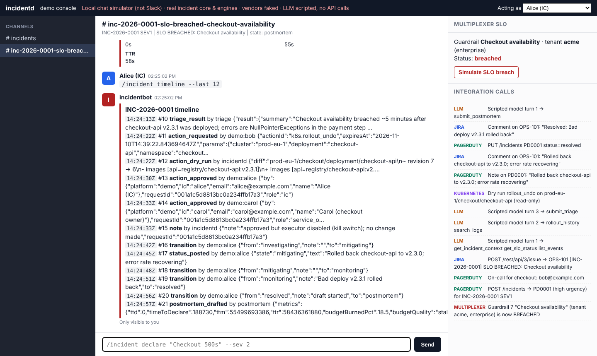

# Demo

**Video:** [`docs/demo/incidentd-demo.mp4`](demo/incidentd-demo.mp4) (90 seconds, 1440×860, no audio, on-screen captions)

[](demo/incidentd-demo.mp4)

## What it shows

1. Multiplexer reports the enterprise tenant `acme` breaching its checkout SLO. The bot **proposes** SEV1 on the first evaluation and **auto-declares** on the second. It creates the war room, pages PagerDuty and files a Jira ticket.
2. Alice takes the vacant IC role and moves the incident to *investigating*.
3. `/incident triage`:
   - five read-only tool calls;
   - a ranked hypothesis (bad deploy v2.3.1) with three cited pieces of evidence;
   - one uncited hypothesis and one non-catalog action **dropped by code**;
   - a token and an email in the log data are redacted before the model sees them.
4. Bob requests the suggested `k8s.rollout_undo`, which produces a dry-run diff and an approval card.
   - Bob's own approval is refused (he is the requester).
   - Alice approves as IC and Carol as service owner.
   - The executor kill switch is off, so the result is **dry-run only**.
5. Alice moves the incident through mitigating, an update (mirrored to PagerDuty and Jira), monitoring and resolved. The SLO is still breached, and the bot does **not** re-declare it.
6. `postmortem draft` shows timings, error budget burned, a blameless narrative and action items. `timeline` shows the hash-chained audit log.

| | |
|---|---|
|  |  |
|  |  |
|  |  |

## How it was made

`cmd/demo` runs the **real** incident core, Multiplexer poller, triage engine (prompt,
guardrails, validation), remediation engine (catalog, approval policy, timeline
re-check, kill switch) and postmortem engine. Only the edges are simulated:

| Real | Simulated |
|---|---|
| core.Service, timeline, severity policy, commands, RBAC | Chat: a local web console, **not Slack** (rendering is simplified) |
| ingest.Poller | Multiplexer: in-memory guardrail you can breach with a button |
| triage.Engine incl. redaction, citation and catalog checks | LLM: scripted turns, no API calls |
| remediation.Engine incl. approvals and the timeline re-check | Kubernetes: dry-run diff only |
| postmortem.Engine, metrics | PagerDuty and Jira: in-memory, logged in the right-hand panel |

`cmd/demo/demo_test.go` drives the same flow headlessly in CI, so the demo can't silently break.

## Run it yourself

```bash
go run ./cmd/demo -listen 127.0.0.1:8090
```

Open <http://127.0.0.1:8090>, click **Simulate SLO breach**, switch users with *Acting as*, and type
`/incident …` commands. Prometheus metrics are at <http://127.0.0.1:8090/metrics>.

## Re-record the video

```bash
go run ./cmd/demo -listen 127.0.0.1:8090 &
```

```bash
node docs/demo/record-demo.mjs http://127.0.0.1:8090 docs/demo
```

```bash
ffmpeg -i docs/demo/incidentd-demo.webm -c:v libx264 -crf 26 -pix_fmt yuv420p -movflags +faststart -an docs/demo/incidentd-demo.mp4
```

The script needs Node 18+ and Playwright with Chromium.
