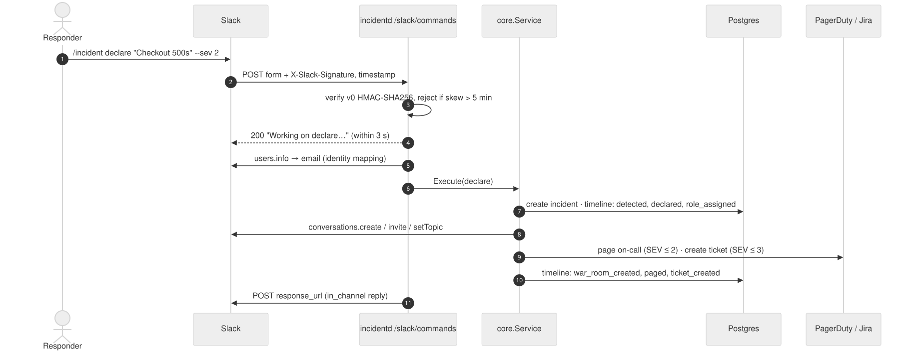
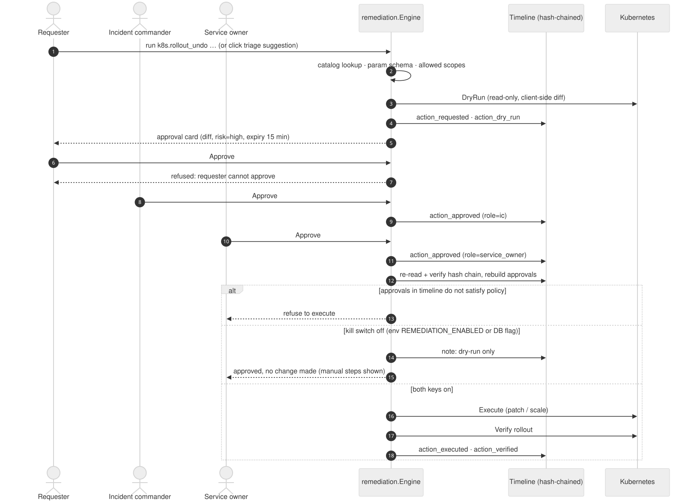

# Diagrams

Mermaid sources are in [`diagrams/`](diagrams/), rendered to SVG (shown here) and 2× PNG.
Re-render with `docs/diagrams/render.sh`.

## Component architecture

One Go service. Chat and ingest adapters feed the incident core, which drives the triage,
remediation and postmortem engines. All vendor access goes through `providers/` (ports and adapters).

## Deployment topology

Public ingress exposes only the chat and webhook paths. Metrics stay cluster-internal. Read-only
RBAC is bound per allowed namespace; the remediation Role ships but is not applied in v1.

## Data flow: signals → incidents

How a Multiplexer SLO status or a PagerDuty webhook becomes an attached signal, a proposal or an
auto-declared incident, including de-duplication and post-resolve suppression.

## Data flow: AI triage and trust boundaries

What the model can reach (read-only tools), what it sees (redacted, wrapped data) and what is
enforced in code after it answers.

## Sequence: a Slack command

## Sequence: human-in-the-loop remediation

## Incident lifecycle

## Data model (Postgres)

