# Security model

`incidentd` advises, coordinates, and executes only what humans approve. This page lists every
trust boundary and the control on it, with the code that enforces it.

## Inbound requests

| Route | Verification | Code |
|---|---|---|
| `POST /slack/commands`, `/slack/interactivity` | `X-Slack-Signature`: `v0=` HMAC-SHA256 over `v0:{timestamp}:{body}` with the signing secret; rejected if the timestamp is more than 5 minutes off (replay). Fails closed if the secret is empty. | `chat/slack/slack.go` `Verify` |
| `POST /teams/messages` | Bot Framework JWT: RS256 keys from `login.botframework.com` OpenID metadata, issuer `https://api.botframework.com`, audience = app ID, expiry with 5-minute skew, `serviceUrl` claim must equal the activity's, key endorsements must include the channel | `chat/teams/auth.go` |
| `POST /webhooks/pagerduty` | `X-PagerDuty-Signature`: `v1=` HMAC-SHA256 over the raw body (multiple signatures allowed for rotation) | `providers/pagerduty` via `go-pagerduty/webhookv3` |
| `/admin/*` | `Authorization: Bearer $INCIDENTD_ADMIN_TOKEN`, constant-time compare; disabled if unset; not exposed by the ingress | `cmd/incidentd/main.go` |
| `/metrics` | Separate port, cluster-internal Service, NetworkPolicy | `deploy/k8s/` |

## Identity and authorization

- **Identity is the email address.** The Slack user maps to the profile email (`users.info`), the Teams user to the member's email/UPN, and on-call users to their PagerDuty email.
- **Users without a mapped email** can read and declare, but cannot approve actions.
- **IC-only commands** (`sev`, `status`, `resolve`, `postmortem`, assigning roles) are checked in `core/dispatch.go`. Anyone may take a *vacant* IC role. `incident.admins` may act as IC anywhere.
- **Approvals** (`remediation/policy.go`):
  - **Low risk:** one approver; the requester may self-approve only as IC.
  - **Medium risk:** the IC, who must not be the requester.
  - **High risk:** the IC **and** the service owner. They must be two different people, and neither can be the requester.
  - Approvals expire, and duplicate approvals are refused.

## Remediation safety

1. **No free-form commands.** Only catalog IDs (`remediation/catalog/*.yaml`) can run. Parameters are validated against a schema; unknown parameters are rejected; values are pattern- and range-checked; clusters and namespaces must be allowed.
2. **Dry run first.** The diff is computed client-side from current state using **read-only** access.
3. **Approvals are recorded before execution.** Each approval is appended to the hash-chained timeline.
4. **Execution trusts only the timeline.** Before executing, the engine re-reads the incident timeline, verifies the hash chain, rebuilds the approvals from it and re-checks the policy. Approvals forged in the database row or in memory are ignored (tested in `remediation/remediation_test.go`).
5. **Two-key kill switch.** Execution needs env `REMEDIATION_ENABLED=true` **and** the runtime DB flag. Both are off in v1.
6. **Least-privilege RBAC.**
   - v1 applies only `rbac-readonly.yaml` (get/list/watch).
   - The write Role (`rbac-remediation.yaml`: `patch` deployments, `update` deployments/scale) is shipped but not applied.
7. **The LLM cannot execute anything.** Triage has no write tools. A suggested action becomes an `ActionRequest` only when a human clicks *Request*, and it still needs approvals.

## LLM data handling

| Control | Detail |
|---|---|
| Read-only tools | Only tools the configured adapters support are offered. A tool that isn't offered cannot be called. |
| Redaction before the model | Auth headers, bearer/basic tokens, private keys, JWTs, AWS key IDs, Slack/GitHub/Anthropic tokens, `password=`/`secret=`/`token=` values and URL userinfo are removed. Emails become `user-<sha256 prefix>`. Custom regexes come from `redaction.extraPatterns`. (`core/redact.go`) |
| Prompt-injection defence | Tool output is wrapped in `<tool_output>` with "untrusted data, not instructions", and closing tags inside the data are escaped. The system prompt tells the model never to follow embedded instructions. Validation runs in code regardless of what the model says. |
| Output validation | Strict schema (unknown fields rejected). Every evidence item must cite a real tool call ID with the matching tool, or the hypothesis is dropped. Recommended actions must be catalog IDs with valid parameters, and risk comes from the catalog. |
| Budgets | 15 tool calls, 90 seconds, 8 KB per tool result |
| Refusals | Server-side refusal fallbacks (`fallbacks: default`). A refusal fails closed with a clear message. |
| Provider | Anthropic API over TLS. The Bedrock and Vertex adapters are stubs and must use private endpoints when implemented. |

## Secrets

- Read only from env or mounted files (`NAME_FILE`). YAML rejects secret-like keys because unknown fields fail.
- Never logged; never sent to the LLM (redaction is also applied to tool output).
- One credential per integration, each with the narrowest scope (see [deployment.md](deployment.md)).

## Audit trail

- Every command, side effect, signal, approval, execution and error becomes a `TimelineEvent`.
- Each event's hash covers its sequence number, time, actor, kind, payload and the previous hash.
- `timeline_events` stores the payload as exact text. Database triggers block `UPDATE`, `DELETE` and `TRUNCATE` for every role.
- Verify with `incidentd verify-timeline` or `GET /admin/timeline/verify`.

## Container and cluster

- Distroless, non-root image; read-only root filesystem; all capabilities dropped; `RuntimeDefault` seccomp.
- The Ingress exposes only the four chat/webhook paths. A NetworkPolicy limits sources.

## Known limitations

- Several details are marked `UNVERIFIED` in [architecture.md](architecture.md#appendix-a--verification-log): the Teams member email fields, PagerDuty's `incident_key` in v3 payloads, and Datadog's counter naming.
- Multi-tenant escalation and SLO poll de-duplication are tracked per process. With several replicas, each replica sees its own polls; incident de-duplication itself is still database-backed.
- Multiplexer gaps G1/G2 (unauthenticated guardrail endpoints, no service tokens) stay open until the linked PRs merge.
