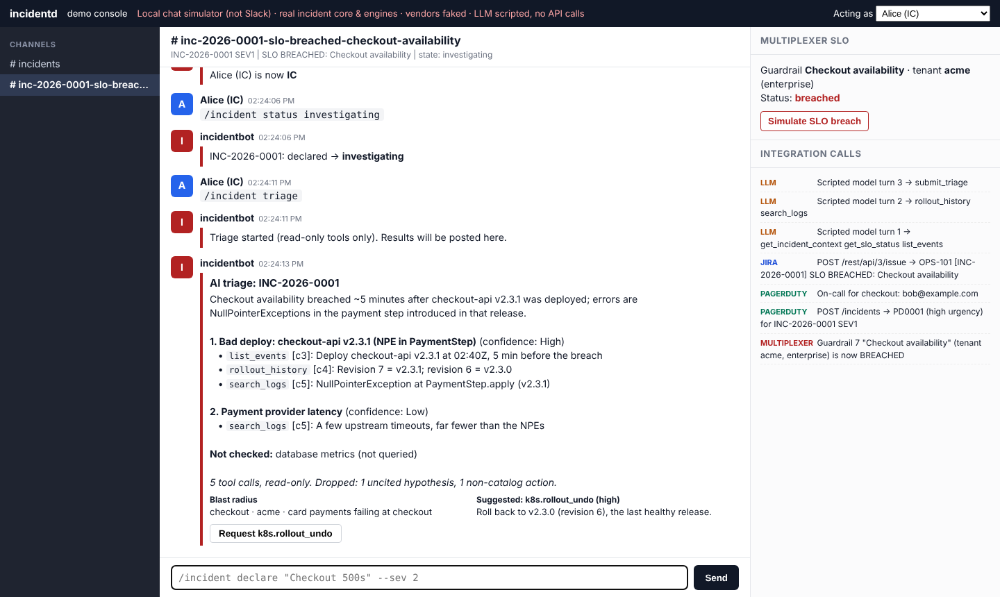
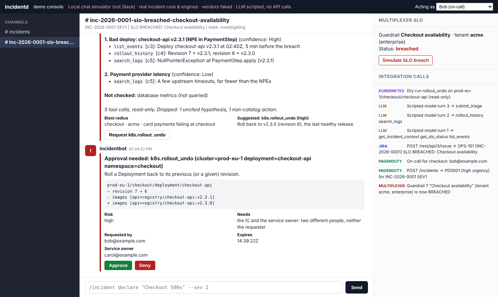

# Responder guide

How to run an incident with `incidentd` from Slack or Teams.

- **Slack:** type `/incident <command>`.
- **Teams:** mention the bot (`@IncidentBot <command>`), and add `--incident INC-YYYY-NNNN` because
  Teams incidents run in the announce channel.

## The 3 a.m. version

1. **Declare:** `/incident declare "Checkout 500s" --sev 2 --service checkout`
   - This opens a war room, makes you IC, pages on-call (SEV1/SEV2) and files a Jira ticket (SEV1–SEV3).
2. **Work it:**
   - `/incident status investigating`
   - `/incident triage` for an AI summary with cited evidence
   - `/incident role comms @bob`
3. **Tell people:** `/incident update "Rolled back; error rate recovering"`. Posts to the announce channel, PagerDuty and Jira.
4. **Fix it:** use `run <action>` or the button on a triage suggestion. Approvers click Approve.
5. **Close it:** `/incident resolve "Bad deploy rolled back"`, then `/incident postmortem draft` and `/incident postmortem publish`.

## Commands

| Command | Example | Who |
|---|---|---|
| `help` | `help` | anyone |
| `declare` | `declare "Payments failing in EU" --sev 1 --service payments,checkout --private` | anyone |
| `sev` | `sev 1 --reason "all regions affected"` | IC |
| `role` | `role ic me` (if vacant) · `role comms @bob` · `role ops @carol` · `role scribe @dan` | IC (anyone can take a vacant IC) |
| `status` | `status` (shows state and next states) · `status mitigating` | IC to change |
| `update` | `update "Mitigation in place; monitoring"` | IC or comms |
| `triage` | `triage` · `triage --focus "database"` | any participant |
| `run` | `run k8s.rollout_restart cluster=prod-eu-1 namespace=checkout deployment=api` | any participant; needs approval |
| `resolve` | `resolve "Root cause: bad config in v2.3.1"` | IC |
| `postmortem` | `postmortem draft` · `postmortem publish` | IC |
| `timeline` | `timeline` · `timeline --last 30` | anyone |

Quotes can be straight or curly (`"…"` or `“…”`). Admins listed in `incident.admins` can act as IC
on any incident.

## Severity

| Severity | Typical meaning | Bot behaviour |
|---|---|---|
| SEV1 | Enterprise tenants down, or widespread breach | Pages on-call, Jira ticket, 30-minute update cadence, postmortem required |
| SEV2 | Major degradation | Pages on-call, Jira ticket, 60-minute cadence, postmortem required |
| SEV3 | Minor / single starter tenant | Jira ticket, no page |
| SEV4 | Cosmetic / monitoring gap | War room and timeline only |

Your company may override the matrix (see [configuration.md](configuration.md#incident)).

## Proposals and auto-declare

When Multiplexer reports an SLO problem:
- SEV1/SEV2 for a known tenant tier, persisting for two evaluations: the bot **auto-declares**. The IC role is
  vacant, so the first responder runs `role ic me`.
- Otherwise the bot posts a **proposal** in the announce channel with **Declare** and **Dismiss**.
- The same breach never creates two incidents. A PagerDuty page for it attaches to the same incident.
  After you resolve, it is not re-declared until the SLO recovers.

## AI triage

`/incident triage` runs read-only queries and replies with:
- a summary and blast radius;
- up to three **hypotheses** with a confidence bucket (Low/Med/High), each with **cited evidence**
  (tool and call ID). Hypotheses without valid evidence are dropped automatically;
- **suggested actions** from the approved catalog only, each with a *Request* button;
- what it **didn't check**.

It cannot change anything. Treat it as a fast junior investigator: check the evidence it cites.

## Running a remediation action

1. `run <actionId> key=value …`, or click *Request* on a triage suggestion.
2. The bot validates the parameters against the catalog and shows a **dry-run diff** and an approval card.
3. Approvals:

   | Risk | Who must approve |
   |---|---|
   | low | One person; the requester only if they are the IC |
   | medium | The IC, who must not be the requester |
   | high | The IC **and** the service owner: two different people, neither the requester |

   Approvals expire after 15 minutes (configurable). Your chat account must map to an email to approve.
4. If execution is enabled, the action runs and is verified. **In the current phase execution is off**, so
   you will see "dry-run only". Make the change by hand using the diff shown.

Current catalog: `k8s.rollout_restart` (low), `k8s.scale_deployment` (medium, 1–50 replicas),
`k8s.rollout_undo` (high).

## Postmortems

- `postmortem draft` (after `resolve`) computes:
  - **TTD**: detection minus impact start;
  - **TTA**: acknowledgement minus detection;
  - **time to declare**;
  - **TTM**: first entry into `monitoring` minus impact start;
  - **TTR**: resolution minus impact start;
  - **error budget burned** (from Multiplexer);
  - **similar past incidents**.

  It drafts the narrative sections in blameless language and flags any blaming phrases.
- Review and edit the draft, then run `postmortem publish`. That creates Jira tickets for the action items and closes the incident.
- SEV1/SEV2 incidents cannot be closed without a published postmortem.

## Tips

- Run commands **in the war room**, or add `--incident INC-…` anywhere.
- `status` with no argument shows the allowed next states.
- Reopening: `status investigating` within 72 hours of resolution. After that, declare a new incident.
- Every action is in `timeline`, a tamper-evident audit log.
